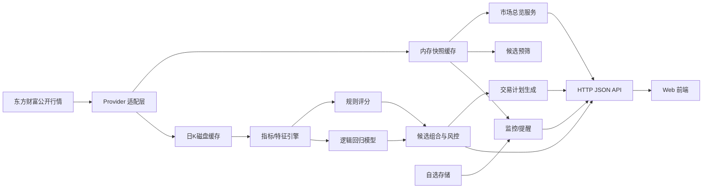

# A股雷达 · 产品与技术设计说明

版本：0.7.0  
定位：本地运行、风险优先、可解释的 A 股研究工具，不是荐股软件，也不是自动交易系统。

---

## 1. 产品定义

### 1.1 一句话

**把“市场环境 → 个股证据 → 上涨概率 → 错了怎么办”压缩到一页，让个人投资者在出手前完成一次结构化检查。**

### 1.2 目标用户

- 有 A 股账户、但不希望被信息流和荐股群牵着走的个人投资者；
- 能理解“概率”“止损”“仓位”的含义，愿意自己做最后决策；
- 需要每天花 10–20 分钟完成盘前/盘中观察，而不是全天盯盘；
- 接受“今天没有机会”也是结果。

### 1.3 非目标

- 不承诺收益、不预测确定涨跌；
- 不接券商、不自动下单、不代客理财；
- 不做付费荐股、不制造“内幕消息”；
- 不追求机构级高频/Level-2/另类数据能力。

### 1.4 核心用户任务（Jobs to be Done）

1. **盘前/盘中 30 秒**：今天市场适合进攻、观察还是防守？
2. **选股 5 分钟**：哪些标的同时具备趋势、量能、相对强度和可控风险？
3. **下单前 1 分钟**：关注区间、止损、目标、仓位是多少？什么情况证明我错了？
4. **持仓后**：自选是否触发买区、止损、目标或量价异动？
5. **复盘**：模型最近是否衰减？我是在按规则执行，还是在追涨？

---

## 2. 网上同类工具拆解

“优先结合网上已有的类似工具”不等于把别人的页面嵌进来。这里的做法是：**拆解成熟产品的信息架构与研究方法，用公开数据重新实现一个更轻、更透明、可本地运行的版本。**

| 产品/项目 | 值得借鉴 | 不直接照搬 | 本项目落地 |
|---|---|---|---|
| **东方财富 / 同花顺** | 全市场行情、板块、自选、异动提醒；A 股用户习惯 | 广告、资讯流、弹窗、信息过载；页面重 | 全市场快照 + 板块 + 自选提醒，但去掉资讯噪音 |
| **TradingView** | 图表交互、指标叠加、筛选器 | 社交与付费订阅；移动端复杂 | 本地 ECharts K 线 + MA + 成交量，详情页一屏读完 |
| **Finviz** | 热力图、筛选器、信息层级 | 以美股为主；字段体系不同 | 板块热度条 + 候选卡片 + 因子条 |
| **雪球** | 社区情绪、讨论热度 | 情绪噪声大、容易反向指标 | MVP 不接入社区；路线图再做“情绪”但只做辅助 |
| **聚宽 / 米筐** | 研究 → 回测 → 模拟 → 实盘的流程分层 | 平台绑定、学习成本高 | 本地研究工具，明确不进入实盘执行 |
| **AkShare** | 多数据源接口、字段标准化、工程化 | 接口多、依赖重 | 借鉴适配器边界；当前只保留东方财富轻量实现 |
| **Qlib** | 因子库、模型库、滚动验证、研究流水线 | 面向机构研究，部署重 | 借鉴时间切分验证、特征工程和模型卡 |
| **Backtrader / vn.py** | 回测与交易执行分离 | 本项目不做执行 | 明确“信号/计划/执行”三层边界 |
| **幻方量化** | AI 量化、因子工业化、算力投入、风险约束 | 私募策略、数据、算力不可复制 | 只借方法论：因子流水线、滚动验证、模型衰减监控 |

### 2.1 差异化

1. **风险先于收益**：每个候选先有止损和失效条件，再谈目标。
2. **概率必须带基准**：不只显示 43%，还显示基准 43%、相对 +0.1pp，避免“43% 看起来像看跌”的误读。
3. **允许空仓**：候选不足 2 只时不补位，直接告诉用户“今天不凑数”。
4. **本地、可审计**：Python 源码、公开接口、模型卡、缓存路径全部可见。
5. **不碰交易执行**：降低合规与操作风险，专注研究与纪律。

---

## 3. 从幻方量化借鉴什么

幻方量化官方介绍的关键事实：

- 2008 年开始用机器学习探索全自动量化交易；
- 2016 年 10 月第一份由深度学习生成的交易仓位上线；
- 2017 年全面应用深度学习；
- 持续投入“萤火”算力集群（2019 年萤火一号、2021 年萤火二号）；
- 核心能力是“用科学理解金融市场，对金融资产进行定价和投资”。

这些是**机构级能力**：数据、算力、人才、交易执行、合规，个人无法照搬。可迁移的是方法论：

| 机构实践 | 个人版翻译 | 本项目 |
|---|---|---|
| 海量数据 + 算力 | 不追求全量，先保证数据及时、干净、可追溯 | 全市场快照 + 日 K 缓存 + 数据质量标记 |
| 因子工业化 | 固定字段、固定计算、固定验证流程 | 11 个特征 + 8 组规则因子 + 统一评分 |
| 深度学习/集成模型 | 先用可解释线性模型建立基线 | L2 逻辑回归 + 时间切分 + 校准 |
| 滚动验证/防未来函数 | 按时间切分，不用未来数据 | 70/30 日期切分，标签未来 10 日 |
| 风险约束/组合优化 | 不优化到极致，先限制单票/行业/波动 | 三档风险阈值、行业上限、ATR 止损、仓位上限 |
| 模型监控/衰减 | 每次展示 AUC、样本量、置信度 | 模型体检卡 + 低置信提示 |

**不声称**：本项目的收益、AUC、命中率与幻方或任何机构产品可比。公开数据 + 线性模型 + 零售数据预算，只能得到一个弱的、需要持续验证的参考信号。

参考：
- 幻方官网：<https://www.high-flyer.cn/>
- 幻方量化基金页：<https://www.high-flyer.cn/fund/>
- 幻方历程：<https://www.high-flyer.cn/history/>

---

## 4. 系统架构



### 4.1 分层

1. **数据层**：`app/providers/eastmoney.py`
   - 全市场快照（分页并发）、指数、行业板块、日 K、批量报价。
   - 分页失败会串行补抓一次；仍失败则降低覆盖并明确返回 coverage/pageFailures。
   - 重试、超时、连接池；失败时读取陈旧缓存并标记。
2. **缓存层**：`app/cache.py`
   - 全市场快照：内存 25 秒。
   - 日 K：JSON 磁盘缓存，盘中 5 分钟 / 收盘后 6 小时。
   - 指数走势：10 分钟。
3. **特征层**：`app/services/indicators.py`
   - SMA/EMA、RSI(Wilder)、MACD、ATR(Wilder)、OBV、20 日高低点、相对强弱。
   - 训练样本只用 `t` 日及之前的数据，标签为 `t+10`。
4. **评分层**：`app/services/scoring.py`
   - 八组规则因子 → 0–100 规则分。
   - 交易计划：ATR、结构位、盈亏比、仓位。
5. **模型层**：`app/services/model.py`
   - 标准化 + L2 逻辑回归 + 时间切分 + 等频保序校准。
6. **编排层**：`app/services/market.py`
   - 预筛、K 线加载、候选构建、模型分位、档位过滤、自选监控。
7. **接口/展示层**：`server.py` + `web/`
   - 标准库 HTTP 服务，无 Web 框架依赖；JSON API；单页前端。

### 4.2 为什么不用 FastAPI/React

- 目标环境是 Windows 本机，Python 已具备，Node 不一定有；
- 依赖越少，首次启动越稳；
- 单页原生 JS + 本地 ECharts 已足够；
- 代价是路由/静态服务要自己写，但代码量可控，便于审计。

### 4.3 实时性与延迟预算

```text
交易所撮合
  → 行情商采集/缓存          毫秒–数秒，不可控
  → 公开 HTTP 接口           约 1–10 秒，不可控
  → /api/live 批量请求       约 30–300ms，可优化
  → 浏览器局部渲染           < 50ms，可优化
  → 1 秒轮询间隔             可配置
```

- `/api/live` 只做两件事：批量自选报价 + 指数报价；不做全市场快照、不重算模型。
- 前端 1 秒轮询，只更新价格、涨跌幅和“下一步”，不整页重绘；页面隐藏时暂停。
- 公开源是快照式 L1，不是逐笔/盘口；**不存在“零延迟”**。页面文案写“1s 刷新”，不写“实时无延迟”。
- 需要更低延迟时，替换 Provider：券商 QMT/Ptrade、券商 L2、Wind/Choice 或交易所授权源；网络层可改 WebSocket/专线。即使如此仍是低延迟，不是零延迟。
- `f124` 时间戳可用于诊断，但供应商时钟可能存在偏差，不作为对用户的硬性延迟承诺。

### 4.4 轮询与稳定性

- 自选页：1 秒 `/api/live`；失败时回退到 5 秒 `/api/watchlist`。
- 市场总览：20 秒全市场快照；1 秒只更新指数。
- 候选页：90 秒重算，避免频繁训练/抓 K 线。
- 输入框聚焦、说明面板收起、详情弹窗打开时，不被轮询重绘打断。

### 4.5 设备与部署形态

| 场景 | 运行方式 | 访问 | 安全边界 |
|---|---|---|---|
| 本机 | `run.bat` / `server.py --host 127.0.0.1` | `127.0.0.1:8765` | 默认无密码，仅本机 |
| 同一 Wi-Fi 手机/电脑 | `run-lan.bat` / `--host 0.0.0.0 --password ...` | `http://局域网IP:8765` | HTTP Basic；仅可信局域网 |
| 异地组网 | Tailscale/ZeroTier + 密码 | `http://100.x.x.x:8765` | 组网层加密 + Basic |
| 公网 | VPS + Caddy/Nginx + HTTPS | 域名 | TLS + 反向代理鉴权 |
| 手机主屏幕 | manifest + 图标 | Safari/Chrome 添加到主屏幕 | HTTPS 下体验最完整 |

- 非 loopback 监听被强制要求 `--password`，除非显式 `--allow-no-auth`；
- Basic Auth 在 HTTP 下是明文，不能直接用于公网；公网必须 HTTPS；
- 不把 8765 直接端口转发到公网；服务没有账号体系、限流和 WAF；
- 手机端使用同一套响应式页面，不维护第二套客户端。

---

## 5. 数据设计

### 5.1 快照字段

`f2` 现价、`f3` 涨跌幅、`f4` 涨跌额、`f5` 成交量、`f6` 成交额、`f7` 振幅、`f8` 换手率、`f9` 动态 PE、`f10` 量比、`f12` 代码、`f13` 市场、`f14` 名称、`f15/16/17/18` 高/低/开/昨收、`f20/21` 总/流通市值、`f22` 涨速、`f23` PB、`f24` 60 日涨跌、`f25` 年初至今、`f62` 主力净流入、`f100` 行业。

标准化后统一为：

```json
{
  "code": "603580",
  "secid": "1.603580",
  "name": "艾艾精工",
  "price": 63.3,
  "pct": 3.69,
  "amount": 123456789,
  "turnover": 5.2,
  "volume_ratio": 2.97,
  "pe": 120.5,
  "market_cap": 8000000000,
  "main_inflow_ratio": 0.03,
  "industry": "塑料",
  "limit_pct": 10,
  "is_st": false,
  "is_limit_up": false
}
```

### 5.2 数据质量

- 快照覆盖 < 75% 时抛错，避免用半截市场算宽度；
- 单只股票 K 线失败不影响整个扫描；
- 页面显示快照年龄、是否 stale、最近错误；
- 节假日没有单独日历，使用“数据日期 + 行情时间 + 交易时段”综合提示，避免假装实时。

---

## 6. 因子与评分

### 6.1 规则因子权重

| 因子 | 权重 | 主要信号 | 设计意图 |
|---|---:|---|---|
| 趋势结构 | 22% | 价格 > MA20、MA20 > MA60、MA20 斜率、MA5/MA20 | 先确认方向 |
| 动量强度 | 18% | 5/20 日涨幅 | 捕捉延续，同时对过热反向扣分 |
| 量能配合 | 12% | 量比、5/20 日均量、OBV | 避免无量上涨 |
| 超买超卖 | 8% | RSI(14) | 偏好 50–68，过滤极端 |
| MACD 动能 | 10% | 柱体零轴与方向 | 辅助确认拐点 |
| 相对强弱 | 10% | 5 日相对沪深 300 超额 | 避免只赚 beta |
| 波动风险 | 12% | ATR%、MA20 乖离、距 20 日高点 | 控制回撤 |
| 资金/估值 | 8% | 主力净流入占成交额、PE | 辅助质量判断 |

### 6.2 规则分的边界

- 每个子分 0–100，按权重加权；
- 超过 68 分进入“正向理由”，低于 45 分进入“风险项”；
- ST、涨停、高波动、乖离过大、高换手、亏损等作为硬 flags；
- 规则分**不是**概率，只用于结构化比较。

### 6.3 预筛

从全市场约 5,000 只中选约 64 只：

- 排除 ST、停牌、价格 < 3 或 > 300；
- 成交额 ≥ 1.2 亿、市值 ≥ 50 亿；
- 换手率 0.8–22%、当日涨跌 −3.5%–+7.8%；
- 60 日涨跌在 −35%–+90%；
- 量比 ≥ 0.55；
- 预筛分 = 涨幅、量比、主力净流入占比、60 日动量、换手适中性；
- 单一行业最多 6 只，保证候选分散。

> 预筛会引入选择偏差，这是模型验证偏乐观的主要原因之一，必须披露。

---

### 6.4 龙头雷达

“龙头”不是单一涨幅冠军，而是市场情绪、资金与板块共振的结果。当前实现拆成四种角色：

| 类型 | 识别方法 | 用途 |
|---|---|---|
| 空间龙头 | 涨停池最高 `lbc`（连板数），再看封单/开板/成交 | 判断短线情绪高度 |
| 成交龙头 | 活跃池内成交额最大（排除 ST/停牌） | 看资金主战场 |
| 趋势龙头 | 活跃池内 60 日涨幅最大（流动性门槛） | 看中期主线 |
| 资金龙头 | 活跃池内主力净流入最大 | 看承接与持续性 |
| 板块龙头 | 领涨行业中领涨股，结合板块涨跌家数 | 看板块内部的辨识度 |

数据来源与计算：

- 涨停池：`push2ex.eastmoney.com/getTopicZTPool`，字段 `lbc` 连板数、`fbt` 首封时间、`zbc` 开板次数、`fund` 封单额、`hybk` 行业；
- 板块：东方财富行业板块的涨幅、领涨股、涨跌家数；
- 个股：全市场快照的成交额、换手、量比、60 日涨跌、主力净流入；
- 龙头分：连板高度 + 成交额 + 板块强度 + 封单质量 + 换手 + 主力净流入；行业最多 2 只，避免榜单被单一板块占满。

边界：

- 涨停池是“封板结果”，不包含盘中曾涨停但开板未回封的股票；
- 「活跃池」= 当日涨停池 + 快照中按涨幅/成交额排前 20 的非涨停股，**不是全市场**；因此成交/趋势/资金龙头可能漏掉池外个股；
- 连板高度越高，次日分歧和回撤风险越大；
- 成交/趋势/资金龙头不是“连板龙头”，只代表某一维度强；
- 本页只做识别，不自动给出买入指令；参与仍需计划、止损和仓位约束。


## 7. 模型卡

### 7.1 任务定义

- 输入：`t` 日收盘后可得的 11 维特征；
- 输出：`close[t+10] > close[t]` 的概率；
- 用途：在候选池内做**相对排序**，不单独作为买卖信号。

### 7.2 特征

| 特征 | 计算 | 方向直觉 |
|---|---|---|
| ret5 | close / close[-6] − 1 | 短期动量 |
| ret20 | close / close[-21] − 1 | 中期动量 |
| trend | close / MA20 − 1 | 趋势位置 |
| ma_gap | MA5 / MA20 − 1 | 短期均线关系 |
| rsi | RSI(14)/100 − 0.5 | 超买超卖 |
| macd | MACD 柱 / close | 动能 |
| vol_ratio | 成交量 / 20 日均量 | 量能 |
| atr_pct | ATR(14) / close | 波动 |
| rel5 | 5 日收益 − 沪深 300 5 日收益 | 相对强弱 |
| dist_high20 | close / 20 日最高 − 1 | 突破/回撤位置 |
| market_ma | 沪深 300 close / MA20 − 1 | 市场状态 |

### 7.3 训练与验证

1. 用候选池 320 个交易日日 K 构建样本；
2. 按日期排序，前 70% 训练，后 30% 验证；训练段末尾**净化 10 个交易日**，避免标签与验证特征重叠；
3. 训练集均值/方差标准化，验证集复用；
4. L2 正则逻辑回归，固定随机性（无随机种子需求）；
5. 验证集上做 10 等频分箱 + PAVA 保序校准；
6. 用全量数据重训最终模型，校准参数保留验证集结果；
7. 页面展示**池化 AUC / 日度截面 AUC / Rank IC / ICIR / Top 10% 命中率 / 基准 / 超额 / Brier**、样本量、时间范围、特征权重。

### 7.4 为什么是 10 日

- 1 日方向噪声太大，AUC 常在 0.51–0.52；
- 5 日有所改善，但仍受隔夜跳空影响；
- 10 日与“5–15 个交易日”的交易计划一致；
- 代价是标签重叠，验证样本不独立；因此采用净化切分，并同时看日度截面指标。

### 7.5 已知偏差

- **选择偏差**：训练池来自今天筛选出的活跃股，不是全市场随机样本；
- **幸存者偏差**：退市/长期停牌股票不在当前候选池；
- **重叠窗口**：10 日标签让相邻样本高度相关，独立交易日远少于样本数；
- **未计成本**：验证收益未扣手续费、印花税、滑点；
- **不可成交**：涨停、停牌、流动性不足时信号无法执行；
- **事件缺失**：公告、财报、政策、突发新闻未进入特征；
- **市场风格漂移**：模型可能在某段行情有效、另一段失效；滚动验证常出现正负 IC 交替。

### 7.6 监控与门控

- 每次刷新展示池化 AUC、日度截面 AUC、Rank IC/ICIR、命中率、样本量；
- 模型可用门槛：**日度截面 AUC ≥ 0.52 且 Rank IC ≥ 0.02**；
- 未通过门槛时，模型分位不参与最终排序，候选按 83% 规则分 + 17% 风险分排序；卡片不再展示伪精确的模型概率，改为规则分/风险分；
- 通过门槛时，排序为 50% 模型分位 + 35% 规则分 + 15% 风险分；
- 页面明确“历史验证不代表实盘”。

### 7.7 在线复盘与概率校准

```text
n-2 生成候选并落盘
  → n-1 收盘得到真实次日涨跌
  → 加权命中率 vs 平均预测概率
  → 截距校准 b（强收缩）
  → n 的候选概率应用 sigmoid(logit(p)+b)
```

- 只校准概率截距，不自动调整因子权重；每日样本太少，自动改权重会过拟合。
- 收缩：`b = raw_bias × n/(n+30)`，并限制在 ±0.30 logit；样本为零时 `b=0`。
- 复盘必须使用**已完成的前一交易日**；当日盘中或缓存的未收盘 K 线不进入校准。
- 因子表现只做诊断展示：上涨组/下跌组平均分差，不参与权重更新。
- 持久化：`data/learning.json`，包含候选快照、已结算记录、校准参数。

### 7.8 1 万元模拟盘

- 系统自行决定：均衡档候选，等权分配，最多 5 只；无候选则空仓。
- 买入时点：**信号日收盘**；卖出/计值时点：**下一交易日收盘**（符合 T+1）。
- 成本：0.15% 往返估算；每日固定 10,000 元，不复利，忽略 100 股整数限制。
- 结算后记录每只股票的 entryClose、exitClose、收益、盈亏和组合权益。
- 只有下一交易日收盘后才结算，避免使用未完成 K 线；这是研究模拟，不是实盘成交。
- 持久化：`data/paper.json`，不进入 Git。

### 7.9 模型为什么差，以及优化顺序

当前结果可能是池化 AUC≈0.5、日度截面 AUC 在 0.45–0.52 摆动、Rank IC 正负交替。这不是“再调一下正则”就能解决，按以下顺序处理：

1. **数据**：把训练池从“今天仍活跃的 64 只”改成历史 point-in-time 全市场横截面（含退市/停牌），至少 3–5 年；这是最大瓶颈。
2. **标签**：从绝对 10 日涨跌改为**同日横截面超额收益 / 是否跑赢同日中位数**，减少大盘 beta 主导；再比较多周期标签。
3. **验证**：滚动 walk-forward + purge/embargo，校准集与测试集分开；报告日度截面 AUC、Rank IC、ICIR、Top 10% 超额，不只看一个池化 AUC。
4. **特征**：减少共线技术因子；增加行业相对强度、资金流、流动性/波动状态、市场 regime 交互。
5. **模型**：稳定线性/排序 baseline → 正则化/特征选择 → 树模型或 ensemble；所有选择必须用滚动验证，不能在同一留出集调参。
6. **产品**：IC 不达标就不参与排序、不展示伪精确概率、降低仓位；当前 v0.6 已经这样做。

---

## 8. 候选与风控

### 8.1 准入

在预筛基础上：

1. **模型可用时**：概率 ≥ 基准、模型分位 ≥ 55%；
2. **模型不可用时**：跳过模型门槛，仅用规则分 + 风险分；
3. 规则分 ≥ 42，风险分 ≥ 35；
4. 非 ST、非涨停；
5. 按档位过滤 ATR、市值、趋势分、当日涨幅；
6. 单行业最多 1–2 只。

### 8.2 三档

| 档位 | 最大 ATR | 最小市值 | 最低趋势分 | 最大当日涨幅 | 最多候选 | 单笔风险预算 |
|---|---:|---:|---:|---:|---:|---:|
| 稳健 | 5.5% | 200 亿 | 52 | 5% | 4 | 0.4% |
| 均衡 | 7.5% | 80 亿 | 45 | 7% | 5 | 0.5% |
| 进攻 | 10% | 30 亿 | 38 | 9% | 6 | 0.6% |

> 市值为人民币；风险预算按“总资金 × 单笔风险比例 / 止损距离”估算仓位，并受单票上限约束。

### 8.3 交易计划

- 关注区间：现价 ± ATR 的分数倍；涨幅 > 4% 时改为回踩区间；
- 止损：关注区间下沿 − 1.05×ATR，且不超过现价 −10%；
- 目标 1/2：2R / 3.2R；
- 仓位：`min(单票上限, 风险预算 / 止损百分比)`；
- 失效条件：收盘跌破止损，或行业资金连续两日净流出；
- T+1 提示：当日买入最早下一交易日卖出。

### 8.4 从计划到动作

计划数字不够，必须回答“现在该做什么”：

- **候选卡**增加状态标签与 3 条动作：
  - `等回踩`：现价高于区间，先加自选，不追；
  - `可分批`：已进区间，首笔减半、分 2 笔；
  - `只观察`：模型优势微弱，不执行；
  - `计划失效`：跌破止损，不补仓。
- 每张卡写清“什么情况下放弃”：高开超过区间上沿 2%、跌破止损、大盘放量跳水。
- **自选监控**每行先显示“下一步 / 信号”，把 `可分批 / 不追高 / 观察收回 / 执行止损 / 分批止盈` 放在触发标签之前。
- 从搜索手动加入自选时，服务端自动生成一套关注区间、止损、目标；避免出现“只有代码、没有计划”的死胡同。
- 旧记录缺少计划位时，行内提供“补计划”按钮。

### 8.5 明确不做

- 不融资、不加杠杆建议；
- 不推荐 ST、退市整理、上市初期无历史数据的股票；
- 不追已涨停/接近涨停的标的；
- 不在候选不足时降标准补位；
- 不自动下单。

---

## 9. 信息架构与交互

### 9.1 主导航

1. **市场总览**：先判断环境；
2. **龙头雷达**：识别当前市场总龙头、板块龙头与四类龙头；
3. **今日候选**：再看个股，卡片直接给“怎么执行”；
4. **自选监控**：执行层，每行先给“下一步”；
5. **学习复盘**：n-2→n-1 的校准结果 + 1 万元模拟盘；
6. **方法与风险**：理解模型边界。

### 9.2 视觉

- 深色研究终端风格，红涨绿跌（A 股习惯）；
- 关键数字使用等宽字体，弱化装饰；
- 金色强调“研究/风险”，青色辅助信息，红色/绿色只表达涨跌与风险；
- 卡片密度高，但每张卡只回答一个问题；
- 移动端改为单列，表格变卡片行。

### 9.3 反误导设计

- 概率旁永远有基准；
- 候选卡永远有计划、状态标签与动作清单；
- 动作必须是条件句（“等回到 X”“跌破 Y 停止计划”），不写无条件“买入”；
- 自选每行先显示“下一步”，触发信号只作为辅助；
- 模型弱时提示，不用“AI 推荐”包装；
- 空结果不是错误，而是策略输出；
- 所有页面底部保留免责声明。

---

## 10. 可观测性与迭代

### 10.1 运行指标

- 快照抓取耗时、覆盖数量、失败页数；
- 快照磁盘缓存年龄与 `stale` 标记；
- 行情源熔断次数、`requests`/`curl` 传输兜底次数；
- 东方财富/新浪/腾讯/磁盘缓存的实际来源与降级比例；
- 新浪快照的行业/资金字段缺失数量；
- 板块/指数接口成功率；
- K 线缓存命中率；
- 候选构建耗时；
- 模型 AUC、Brier、Top 10% 命中率、样本量；
- 页面请求错误率（本地控制台）。

### 10.2 研究指标

- 滚动 walk-forward 的 AUC 稳定性；
- 分市场状态（上涨/震荡/下跌）的表现；
- 不同行业、市值、波动分组的偏差；
- 加入交易成本后的净值/回撤；
- 候选与实际次日/10 日收益的对照（需要模拟组合）。

### 10.3 迭代原则

1. 先修数据质量，再调模型；
2. 每次只改一个变量，保留旧基线；
3. 任何新因子必须做时间切分验证；
4. 不因短期表现好就放大仓位；
5. 模型失效时先降风险，而不是加因子。

---

## 11. 路线图

### P0（已实现）

- 实时总览、板块、温度；
- 龙头雷达：涨停池、总龙头、板块龙头、四类龙头与候选；
- 1 秒低延迟模式：自选 + 指数局部刷新，可暂停；
- 三档候选、模型卡、交易计划；
- 在线复盘：n-2→n-1→n 的截距校准；1 万元模拟盘信号日收盘/次日收盘结算（T+1）；
- 3 步使用法、每张卡的“怎么执行”、自选的“下一步 / 信号”；
- 个股详情 K 线、执行清单；
- 自选监控与提醒；手动添加自动生成计划；
- 本地 API、无框架部署、免责声明。

### P1

- 多数据源降级（AkShare/Tushare/腾讯）；
- 公告/新闻摘要与事件过滤；
- 模拟组合：记录候选、持仓、收益、回撤；
- 用户自定义资金、风险预算、行业上限；
- 移动端交互优化与 PWA。

### P2

- 横截面多因子/机器学习模型，行业中性化；
- Walk-forward 滚动训练与模型集成；
- 交易成本、涨跌停可成交性建模；
- 盘后自动报告与定时任务；
- 多市场（港股/ETF）适配。

### 不做

- 自动交易、券商账户接入；
- 收益承诺、付费荐股；
- 用公开数据假装“内幕”；
- 把模型概率当成确定结果。

---

## 12. 关键取舍记录

| 取舍 | 选择 | 理由 |
|---|---|---|
| Web 框架 | 标准库 HTTP | 零安装、Windows 友好、可审计 |
| 前端 | 原生 JS + ECharts | 无构建链，图表本地化 |
| 模型 | 逻辑回归 | 可解释、可校准、训练快；深度学习在零售数据上收益不稳 |
| 标签 | 10 日 | 与交易周期一致；接受重叠偏差并披露 |
| 概率 | 校准 + 基准 | 避免绝对概率误导 |
| 候选 | 宁缺毋滥 | 风险优先；空仓是合法输出 |
| 交易 | 不接入 | 合规与操作风险；工具只做研究 |
| 数据 | 东方财富公开接口 | 免费、字段全、无需 Key；接受非官方与延迟 |

---

## 13. 参考

- 幻方量化官网：<https://www.high-flyer.cn/>
- 幻方基金页：<https://www.high-flyer.cn/fund/>
- 幻方历程：<https://www.high-flyer.cn/history/>
- 东方财富行情：<https://quote.eastmoney.com/>
- AkShare：<https://github.com/akfamily/akshare>
- Qlib：<https://github.com/microsoft/qlib>
- TradingView：<https://www.tradingview.com/>
- Finviz：<https://finviz.com/>
- 聚宽：<https://www.joinquant.com/>
- 米筐：<https://www.ricequant.com/>
- Backtrader：<https://www.backtrader.com/>
- vn.py：<https://www.vnpy.com/>

---

> 本文档是工程与研究设计说明，不构成投资建议。模型、数据和接口均可能变化；任何候选都需独立判断与风险控制。
