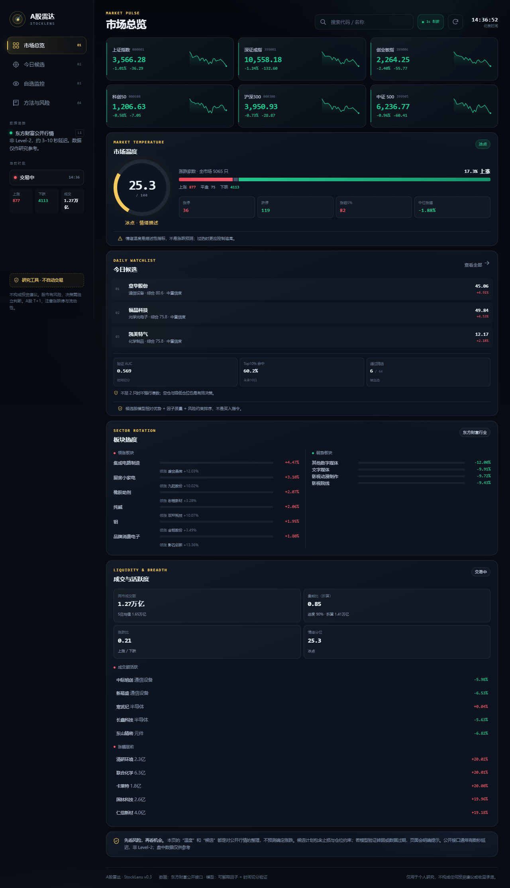
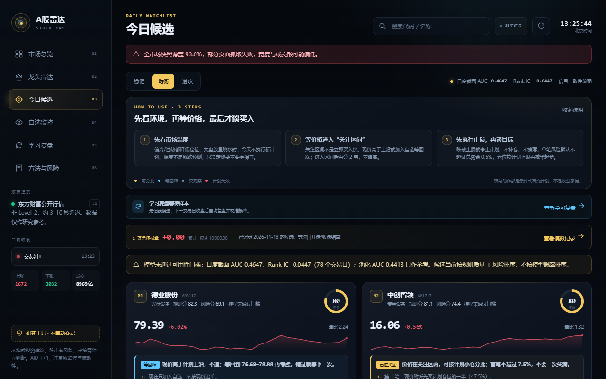
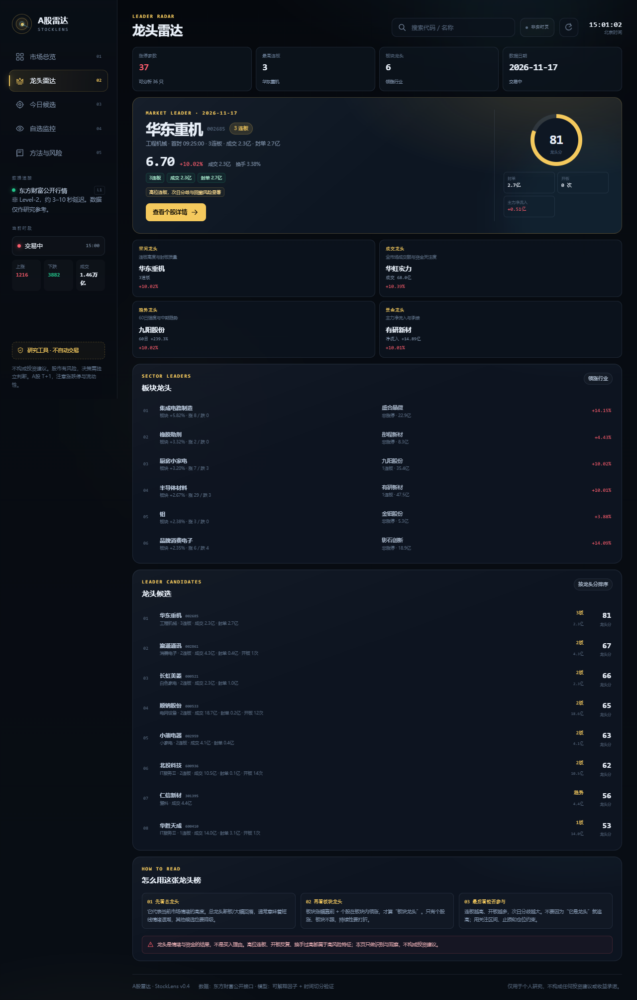
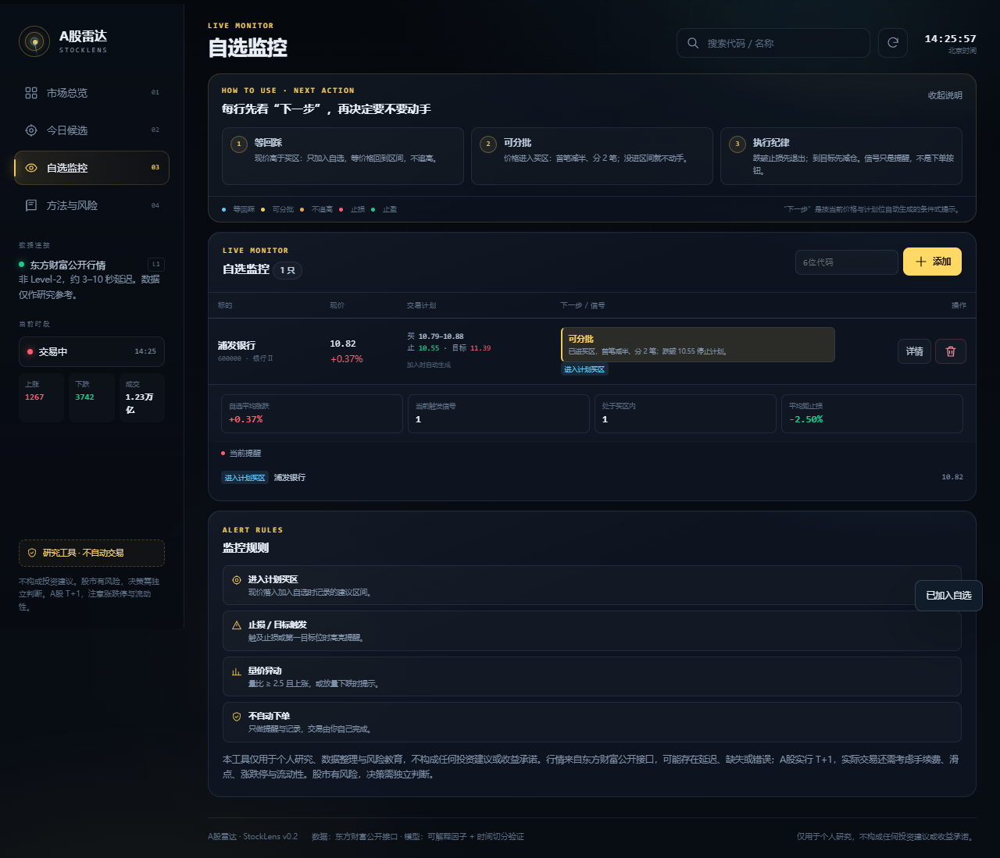
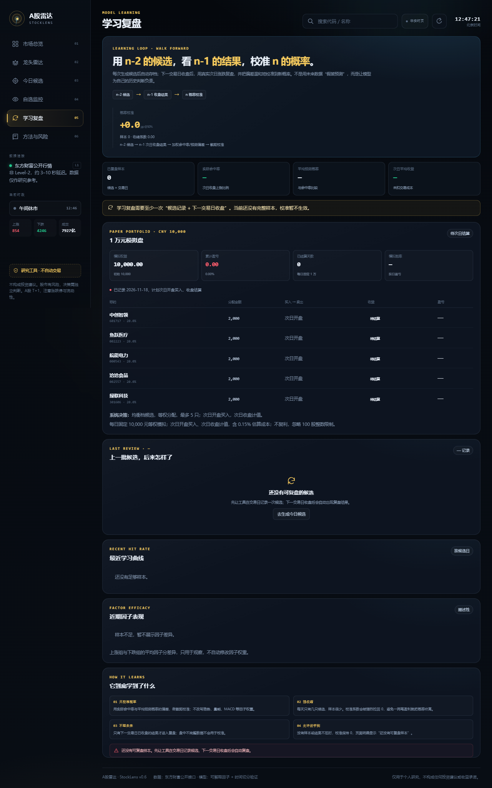
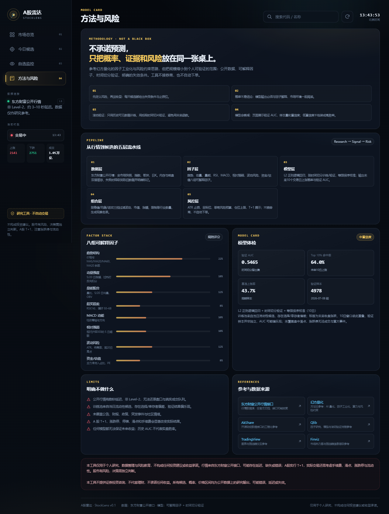

# A股雷达 · StockLens

> 本地运行的 A 股实时观察工具：把**市场温度、板块轮动、可解释因子、10 日上涨概率、止损/仓位计划**放在同一页。它不预测确定未来，不接券商，不自动下单。



## 它解决什么问题

多数散户工具要么信息过载（行情、资讯、弹窗、社区情绪混在一起），要么只给一个股票代码却不解释为什么。这个项目把流程收敛成一句话：

> **先看市场环境，再看个股证据，最后看这笔交易错了会亏多少。**

核心不是“找到明天一定涨的股票”，而是：

- 用全市场快照判断今天值不值得出手；
- 用透明因子和滚动验证给出**相对优势**，而不是包装成确定性；
- 每个候选都带关注区间、止损、目标和仓位上限；
- 候选不足时不凑数，允许输出“今天没有高置信机会”。

## 已实现

| 模块 | 能力 |
|---|---|
| 市场总览 | 6 大指数、涨跌家数、涨跌停、成交额、量能比、情绪温度、领涨/弱势板块、活跃个股 |
| 龙头雷达 | 涨停池连板高度、市场总龙头、板块龙头、空间/成交/趋势/资金四类龙头、龙头候选 |
| 今日候选 | 稳健/均衡/进攻三档；模型分位 + 八组因子 + 风险约束；三档上限 4/5/6 只（默认均衡档 5 只）；每张卡带“3 步执行指引” |
| 涨跌概率 | 未来 10 个交易日收盘上涨概率；时间切分验证 + 等频保序校准；展示基准概率与相对优势 |
| 交易计划 | 关注区间、ATR 止损、目标 1/2、盈亏比、建议仓位、失效条件、T+1 提示 |
| 操作指引 | 页面顶部 3 步使用法；每只候选给出“等回踩 / 可分批 / 只观察 / 计划失效”的条件式动作 |
| 个股详情 | 120 日 K 线、MA5/20/60、成交量、因子评分、关键证据、风险项、执行步骤（3 条） |
| 自选监控 | 1 秒低延迟模式（可暂停）；每行直接显示“下一步”；进入买区、止损/目标、量价异动提醒 |
| 延迟透明 | 顶部 `1s 刷新` 开关、最近抓取时间、请求耗时；明确公开源仍有 3–10 秒延迟，不承诺零延迟 |
| 学习复盘 | n-2 候选 → n-1 次日结果 → n 概率校准；1 万元模拟盘自动记录次日盈亏 |
| 模型体检 | AUC、Top 10% 命中率、基准上涨率、超额、特征权重、训练/验证时间段、样本偏差说明 |
| 方法与风险 | 五层流水线、因子权重、模型卡、明确不做什么、数据与参考来源 |



## 快速开始

### 环境

- Python **3.10+**（开发环境为 3.12）
- 依赖：`requests`、`numpy`
- 不需要 Node.js、数据库或 API Key

### 运行

```powershell
git clone https://github.com/Liuott/stock-radar.git
cd stock-radar
python -m pip install -r requirements.txt
python server.py --port 8765 --warm --open
```

打开 <http://127.0.0.1:8765>。

Windows 也可以直接双击 [`run.bat`](run.bat)。首次启动会抓取全市场快照和候选日 K，通常需要 **5–15 秒**；之后使用内存与磁盘缓存。

### 启动参数

| 参数 | 默认 | 说明 |
|---|---|---|
| `--host` | `127.0.0.1` | `0.0.0.0` 可供局域网访问；非本机监听必须配密码 |
| `--port` | `8765` | 端口 |
| `--user` | `stocklens` | HTTP Basic 用户名 |
| `--password` | 空 | 非本机访问时必填；本机可留空 |
| `--allow-no-auth` | 关 | 明确允许非本机无密码，仅限可信反向代理 |
| `--warm` | 关 | 后台预热行情和候选缓存 |
| `--open` | 关 | 启动后自动打开浏览器 |

## 在手机 / 另一台电脑使用

### 同一 Wi-Fi（最简单）

在运行工具的电脑上双击 [`run-lan.bat`](run-lan.bat)，按提示设置访问密码。启动后控制台会打印：

```text
本机访问：http://127.0.0.1:8765
局域网/手机：http://192.168.x.x:8765
访问保护：HTTP Basic（用户 stocklens）
```

手机或另一台电脑连同一个 Wi-Fi，浏览器打开“局域网/手机”地址，输入：

- 用户名：`stocklens`
- 密码：启动时设置的那个

首次启动 Windows 防火墙弹窗时，允许 Python 访问**专用网络**。如果没有弹窗但手机打不开，在管理员 PowerShell 中放行端口：

```powershell
netsh advfirewall firewall add rule name="StockLens 8765" dir=in action=allow protocol=TCP localport=8765 profile=private
```

> 非本机监听默认强制要求 `--password`；不要用 `--allow-no-auth` 把无鉴权服务暴露到不可信网络。Basic Auth 在 HTTP 下是明文传输，只适合可信局域网；公网必须加 HTTPS。

### 手机主屏幕

页面包含 `manifest.webmanifest` 和图标：

- iPhone Safari：分享 → “添加到主屏幕”；
- Android Chrome：菜单 → “添加到主屏幕/安装应用”。

在局域网 HTTP 下，Android 的完整 PWA 安装可能受限制；先用浏览器访问即可。公网 HTTPS 部署后可获得完整主屏幕体验。

### 不在同一网络（外网）

优先选 **Tailscale / ZeroTier** 这类组网工具，而不是把端口直接映射到公网：

1. 运行工具的电脑和手机都安装 Tailscale，登录同一账号；
2. 在工具电脑上运行 `run-lan.bat` 或：
   ```powershell
   python server.py --host 0.0.0.0 --port 8765 --password "你的密码" --warm
   ```
3. 手机访问 Tailscale 分配的 `http://100.x.x.x:8765`。

其他方案：

- **Cloudflare Tunnel + Access**：有域名时最省事，能加 HTTPS 和身份验证；
- **Caddy/Nginx 反向代理**：部署到 VPS，用 HTTPS + Basic Auth/OAuth；
- **不要**在路由器上直接端口转发 8765；这个服务没有账号体系、没有 TLS，也没有针对公网攻击的防护。

### 部署到 VPS（简述）

```bash
python3 -m pip install -r requirements.txt
python3 server.py --host 127.0.0.1 --port 8765 --password "你的密码" --warm
```

然后让 Caddy/Nginx 监听 443，反向代理到 `127.0.0.1:8765`。Caddy 示例：

```caddy
stock.example.com {
    basic_auth {
        stocklens $2a$14$...   # caddy hash-password 生成
    }
    reverse_proxy 127.0.0.1:8765
}
```

公网部署前请确认：行情接口使用条款、服务器出口网络能访问东方财富、访问日志与隐私、以及是否需要更强的身份验证。**这是个人研究工具，不建议直接开放给公众使用。**

## 安全与隐私

- 仓库**不包含** `data/`、自选股、学习记录、模拟盘、行情缓存、Token、浏览器数据或任何公网隧道配置。
- README 中的 `127.0.0.1` 和 `0.0.0.0` 是**程序绑定地址**，不是你的公网地址，也不能用来访问你的电脑。
- 局域网 IP 只在运行 `run-lan.bat` 时由程序临时打印，不会写进仓库；README 使用 `192.168.x.x` 占位。
- `run-lan.bat` 会强制要求密码；Basic Auth 在 HTTP 下是明文，只适合可信局域网。
- 公网部署必须使用 HTTPS 反向代理，不要把 `8765` 直接端口转发到公网。
- GitHub 仓库只是源代码，不是在线服务；GitHub Pages 不能运行 Python 后端。要在线使用，需要自己的 VPS 或局域网主机。

## 页面

### 市场总览


- 指数卡片带约 26 个交易日走势（含当日），红涨绿跌（A 股习惯）。
- 情绪温度是**描述性指标**：涨跌家数、指数表现、涨跌停结构、量能比加权，不是涨跌预测。
- 盘中成交额会按交易时段进度线性折算，再与 5 日均值比较，避免用半日成交额直接对比全天均值造成“缩量”误判。
- 板块热度来自东方财富行业板块；弱势板块单列，避免只看涨幅榜。
- 涨跌停家数按**全市场快照的涨跌幅阈值**统计（阈值带 0.25pp 容差）；「龙头雷达」用的是东方财富涨停池口径，两者在同一时刻可能相差几只，属于统计口径差异而不是数据错误。
- 右侧“今日候选”显示通过筛选的数量；不足 2 只时会明确提示降低仓位或等待。

### 龙头雷达



回答“当前市场谁是龙头”，不是简单按涨幅排序：

- **总龙头**：在涨停池中按连板高度优先排序选出；封单、成交、开板次数与板块强度体现在龙头分与风险标签里；
- **四类龙头**：空间（连板高度）、成交（成交额）、趋势（60 日强度）、资金（主力净流入），均在「涨停池 + 当日涨幅前 20」的活跃池内选取，不是全市场扫描；
- **板块龙头**：领涨行业 + 行业内领涨股，展示板块涨幅、涨跌家数、龙头连板与成交；
- **龙头候选**：按“龙头分”排序，限制单行业数量，附连板、封单、开板、换手等风险标签；
- 涨停池为空或休市时自动用成交/趋势信号兜底，并明确提示。

> “龙头”是情绪与资金的结果，不是买入理由。高位连板、开板反复、换手过高都属于高风险特征；本页只做识别与观察。

### 今日候选


> 截图是某个运行时点的示例。候选会随行情变化；同一天也可能出现 0 只，这是筛选结果，不是页面故障。

每张卡包含：

- 综合分、模型分位、10 日上涨概率、基准概率、相对优势（pp）；
- **“怎么执行”**：醒目的状态标签 + 一句话结论 + 3 条动作清单，例如“现价高于上沿，不追；等回到 38.97–41.22”“已进买区，首笔不超过 4.2%”；
- 关注区间 / 止损 / 目标 / 建议仓位；
- 正向理由、风险项、硬性 flags（ST、涨停、高波动、高换手、亏损等）；
- 模型优势微弱时会额外标注，不把“接近随机”包装成强信号。

页面顶部还有 **3 步使用法**：先看市场温度 → 等价格进入关注区间 → 先执行止损再谈目标。可随时收起。

### 个股详情

K 线、均线、成交量、因子条、交易计划、执行清单和证据/风险并列展示。图表使用本地 ECharts，不依赖外部 CDN。

### 自选监控



- 从候选一键加入，或输入 6 位代码；从搜索添加时会**自动生成一套关注区间、止损和目标**，不需要先自己算；
- 每行最显眼的是“下一步 / 信号”：等回踩、可分批、不追高、观察收回、执行止损、分批止盈；
- 已进买区会写清楚“首笔减半、分 2 笔、跌破止损停止计划”；
- 旧记录没有计划位时，行内会出现“补计划”按钮；
- 默认 1 秒增量刷新（`/api/live`，见下文「1 秒低延迟模式」）；低延迟关闭或出错时另有 5 秒整表刷新兜底；
- 输入代码时暂停重绘，避免把正在输入的内容刷掉；
- 不自动下单，只做提醒。

### 学习复盘与 1 万元模拟盘



**学习循环：**

- 每个交易日、每个档位保留最后一次候选快照（同日同档位重跑会覆盖），存档“候选日 + 股票 + 原始概率 + 因子分”；
- 下一交易日收盘后，用真实次日收盘价复盘；
- 用实际命中率与平均预测概率的偏差做**温和校准**，只调整概率截距，不改写趋势、量能、MACD 等因子权重；
- 样本少时强收缩：`n` 个样本的调整权重是 `n/(n+30)`，校准上限为 ±0.30 logit，避免一两笔盈利把概率吹高；
- 没有完成样本时校准保持 0，页面明确显示“还没有可复盘样本”。

**1 万元模拟盘：**

- 自动使用**均衡档**候选，每日固定 10,000 元，等权分配到该档上限（最多 5 只）；
- **次日开盘买入、次日收盘计值**，记录每只股票的买入价、卖出价、收益和盈亏；
- 成本按 0.15% 往返估算；不复利，忽略 100 股整数限制；
- 少于 2 只时也会按实际候选数分配（单票风险更高，页面会提示）；
- 模拟盘不接券商、不自动下单，只是研究记录。

### 方法与风险



把模型卡、因子权重、验证指标、局限性和参考来源放在产品内，避免“黑箱荐股”。

## 模型怎么工作

### 目标与标签

- **标签**：未来第 10 个交易日收盘价高于当前收盘价（`close[t+10] > close[t]`）。
- **特征**：5/20 日动量、MA20 乖离、MA5/MA20、RSI(14)、MACD 柱、量比、ATR 波动、相对沪深 300 的 5 日超额、距 20 日高点、市场 MA20 状态。
- **模型**：L2 正则逻辑回归（不是深度学习黑箱），按日期做 70/30 时间切分。页面上的验证指标（AUC、Top 10% 命中率）来自**只用训练段拟合**的模型在留出集上的表现；线上预测权重随后会在全部样本上重训，因此「验证指标」和「实际用于打分的权重」不是同一套参数。
- **校准**：在留出集上做 10 等频分箱 + 保序回归（PAVA），把原始分数映射为观察到的命中率。验证样本 < 500，或分箱命中率没有区分度（PAVA 会把所有箱并成一个点）时，自动回退到 Platt 缩放——否则所有股票会拿到同一个概率。
- **排序**：当日候选池内计算模型分位，再与规则分、风险分加权；模型不可用（验证 AUC < 0.52）时，分位不参与加权而取中性值，排序只由规则分与风险分决定，避免并列概率下由网络返回顺序决定名次。

### 验证指标的含义

| 指标 | 含义 | 注意 |
|---|---|---|
| AUC | 模型把上涨样本排在下跌样本前面的能力 | 0.5 接近随机；0.55 左右只是弱优势 |
| Top 10% 命中率 | 验证集里模型最高 10% 的样本，未来 10 日上涨比例 | 受市场 beta 影响 |
| 基准上涨率 | 同一验证集的自然上涨比例 | 概率必须和基准比较 |
| Top 10% 超额 | 最高 10% 的未来 10 日平均收益 − 基准平均收益 | 未扣交易成本 |
| Brier | 概率预测的平方误差 | 越低越好 |

> 验证池来自“当日流动性候选”的历史数据，存在选择/幸存者偏差；10 日标签窗口相互重叠，样本并非独立。另外三点也会让指标偏乐观：① 训练段末尾 10 个交易日的标签会用到留出集的价格（无 embargo）；② 最终权重在全部样本上重训；③ 校准曲线与评估指标共用同一个留出集。因此页面上的 AUC 和命中率**不能外推为实盘收益**，以每次运行的实际指标为准。

### 候选漏斗

```text
全市场约 5,000 只
  → 流动性/价格/涨跌幅/ST 初筛，约 64 只
  → 模型概率不弱于基准 + 模型分位 ≥ 55%
  → 趋势、风险、规则分、行业分散
  → 稳健/均衡/进攻三档风险阈值
  → 0–6 只观察候选
```

不足 2 只时不强行补位。单只候选的个股风险更集中，页面会建议降低仓位或继续等待。

## 数据源与延迟

- 行情：**东方财富公开行情接口**（`push2.eastmoney.com` / `push2his.eastmoney.com`）。
- 全市场快照分页抓取（每页 100 条，约 55 页），8 线程并发；默认 25 秒内存缓存。
- 日 K 线磁盘缓存：盘中 5 分钟、收盘后 6 小时。
- 公开接口通常有 **3–10 秒延迟**，不是 Level-2，也没有逐笔成交/盘口队列。
- 接口为非官方公开接口，可能变更或限流；程序会优先返回陈旧缓存并在页面标记 `stale`，不会静默伪装成实时。
- 仅用于个人研究；请遵守数据源条款，不要商业转售或大规模爬取。

### 1 秒低延迟模式

页面右上角有 `1s 刷新` 开关（默认开启）：

- 每 1 秒请求 `/api/live`，一次批量获取自选股 + 指数；
- 只局部更新价格、涨跌幅和“下一步”，不整页重绘；
- 页面隐藏时暂停；接口连续失败时另加 5 秒整表刷新兜底；
- 悬停右上角 `1s 刷新` 按钮可看最近抓取时间与服务端请求耗时（页面可视文本只显示北京时间）。

**但这不等于零延迟。** 公开行情源本身是快照式 L1，行情供应商可能每几秒才更新一次；HTTP 请求、网络、浏览器渲染也都有耗时。要真正做到逐笔/盘口级实时，必须换数据源，见下一节。

### 延迟预算与升级路径

| 环节 | 典型耗时 | 能否用当前方案消除 |
|---|---|---:|
| 交易所撮合 → 行情商 | 毫秒级到数秒 | 否 |
| 行情商缓存 → 公开 HTTP 接口 | 约 1–10 秒 | 否 |
| 本机请求 `/api/live` | 约 30–300ms | 已尽量压缩 |
| 浏览器渲染 | < 50ms | 是 |
| 轮询间隔 | 1 秒 | 是 |

如果“没有延时”是硬性要求，需要接入**有授权的实时行情**，例如券商 QMT/Ptrade、券商 Level-2、Wind/Choice、交易所授权行情，并可能使用 WebSocket/专线/托管。即使如此，也只能做到低延迟，物理上不存在绝对零延迟；本项目当前不承诺、也不伪装成逐笔实时。

可扩展点：`app/providers/eastmoney.py` 是数据适配器边界；实现一个同样返回 `fetch_quotes/fetch_indices` 的 Provider，即可替换为券商或付费源。

## 项目结构

```text
stock-radar/
├─ app/
│  ├─ config.py              # 指数、档位、因子权重、免责声明
│  ├─ cache.py               # JSON 磁盘缓存
│  ├─ store.py               # 自选持久化
│  ├─ providers/
│  │  └─ eastmoney.py        # 行情源适配器
│  └─ services/
│     ├─ indicators.py       # 均线/RSI/MACD/ATR/OBV/特征
│     ├─ scoring.py          # 八组因子评分、交易计划
│     ├─ model.py            # 逻辑回归、时间切分、校准
│     ├─ learning.py         # n-2→n-1 在线复盘与概率校准
│     ├─ paper.py            # 1 万元模拟盘
│     └─ market.py           # 编排、缓存、候选、监控
├─ web/
│  ├─ index.html
│  ├─ styles.css
│  ├─ app.js
│  ├─ manifest.webmanifest
│  ├─ icons/                  # 手机主屏幕图标
│  └─ vendor/echarts.min.js
├─ data/                     # 自选、学习记录、模拟盘与行情缓存（运行时生成，不入库）
├─ docs/                     # 截图
├─ tools/                    # 数据探测/服务测试脚本
├─ server.py                 # 标准库 HTTP 服务 + JSON API + Basic Auth
├─ requirements.txt
├─ run.bat / run.ps1         # 仅本机
├─ run-lan.bat / run-lan.ps1 # 局域网 + 密码
├─ LICENSE                   # MIT
├─ README.md
└─ DESIGN.md
```

## API（本地）

| 方法 | 路径 | 说明 |
|---|---|---|
| GET | `/api/health` | 健康检查 |
| GET | `/api/overview` | 指数、宽度、温度、板块、活跃股 |
| GET | `/api/leaders` | 市场总龙头、板块龙头、四类龙头与候选 |
| GET | `/api/learning` | 复盘样本、概率校准、因子表现与 1 万元模拟盘 |
| GET | `/api/picks?profile=balanced` | 观察候选与模型卡；`conservative/balanced/aggressive` |
| GET | `/api/stock/603580` | 个股详情、K 线、因子、计划 |
| GET | `/api/watchlist` | 自选与触发信号 |
| GET | `/api/live` | 1 秒低延迟：批量自选 + 指数快照 |
| POST | `/api/watchlist` | `{code, entry_low, entry_high, stop, target1}` |
| DELETE | `/api/watchlist/{code}` | 移除自选 |
| GET | `/api/search?q=` | 代码/名称搜索 |
| GET | `/api/method` | 方法说明与参考来源 |

所有接口默认无鉴权，仅绑定 `127.0.0.1`。不要把端口转发到公网。

## 配置

- 档位阈值、候选上限、单笔风险预算：`app/config.py` 的 `PROFILES`。
- 因子权重：`app/config.py` 的 `FACTOR_WEIGHTS`。
- 模型窗口/正则/训练轮数：`app/services/model.py`。
- 自选文件：`data/watchlist.json`；学习记录：`data/learning.json`；模拟盘：`data/paper.json`；行情缓存：`data/cache/klines/`。
- 修改 `web/app.js` 或样式后，刷新页面即可（静态资源使用 `no-cache`）。如果浏览器仍缓存，提升 `index.html` 里的 `?v=` 版本号。

## 常见问题

**Q：为什么今天没有 5 只候选？**  
A：筛选是“宁缺毋滥”。候选不足时页面会显示漏斗和原因；这通常意味着市场环境或个股风险不满足条件。

**Q：概率 43% 也能入选？**  
A：概率要跟基准比。若基准是 43%，候选 43.5% 只有极弱优势，页面会标“模型优势微弱”并降置信度。它不是“上涨概率 43% 所以看跌”，而是“在这段历史里，这类信号略高于基准”。

**Q：能自动交易吗？**  
A：不能，也不会做。项目不接券商、不保存账号、不自动下单。

**Q：数据抓不到怎么办？**  
A：先看页面顶部是否有 `stale` 提示；检查网络能否访问东方财富；接口可能临时限流，稍后重试。程序会优先使用最近一次成功缓存。

**Q：可以换成 Tushare/AkShare 吗？**  
A：可以。`app/providers/eastmoney.py` 是适配器边界，按相同字段实现 `fetch_snapshot/fetch_kline/fetch_quotes` 即可替换。路线图里列了多数据源降级。

## 风险与限制

- 本工具仅用于个人研究、数据整理与风险教育，**不构成任何投资建议或收益承诺**。
- 不提供证券投资咨询、不代客理财、不承诺收益。
- 行情可能延迟、缺失、错误；模型可能失效；历史验证不代表未来。
- A 股 T+1、涨跌停、停牌、滑点、手续费、流动性都会改变实际结果。
- 不要使用生活必需资金、借贷或高杠杆参与。
- 训练池选择偏差、10 日标签重叠、未覆盖公告/新闻/政策/社区情绪，是当前版本的明确局限。
- 模拟盘只用**信号日紧邻的下一根**日 K 结算。信号日超出可回溯窗口（约 20 个日历日）仍无法确认该 bar 时，记录会被标记为失效而不是拿错误的价格结算，所以长期不打开页面可能出现「已失效」条目。
- 模型分位只在模型可用（未校准 AUC ≥ 0.52）时展示；模型不可用时排序由规则分与风险分决定，分位取中性值不参与加权。

## 许可证

本项目使用 **MIT License**，见 [LICENSE](LICENSE)。

第三方组件：前端图表使用 [Apache ECharts](https://echarts.apache.org/)（Apache-2.0）；行情数据归东方财富及相关数据源所有，使用时请遵守其条款。

## 参考与借鉴

- [幻方量化](https://www.high-flyer.cn/)：AI 量化、因子工业化、算力投入与风险约束的方法论参考；本项目不复制其私有策略，也不声称达到机构级能力。
- [东方财富行情](https://quote.eastmoney.com/)：行情数据源。
- [AkShare](https://github.com/akfamily/akshare)：开源财经数据接口的工程化参考。
- [Qlib](https://github.com/microsoft/qlib)：因子研究、模型与滚动验证流程参考。
- [TradingView](https://www.tradingview.com/)：图表与筛选器交互参考。
- [Finviz](https://finviz.com/)：市场热力图与信息层级参考。
- [聚宽](https://www.joinquant.com/)、[米筐](https://www.ricequant.com/)：研究 → 回测 → 模拟的流程参考。
- [Backtrader](https://www.backtrader.com/)、[vn.py](https://www.vnpy.com/)：回测/交易系统分层参考（本项目未接入交易）。

## 路线图

- **P0（当前）**：实时总览、候选、模型卡、自选提醒、详情图、风险声明。
- **P1**：多数据源降级、公告/新闻摘要、模拟组合与持仓跟踪、参数化资金与风险预算、移动端优化。
- **P2**：横截面多因子模型、行业中性化、滚动 walk-forward、交易成本建模、定时盘后报告。
- **不做**：自动下单、收益承诺、付费荐股、把公开数据包装成内幕信息。

---

**一句话**：它是一个让你在买入前多问三个问题的工具——市场适合吗？证据够吗？错了怎么办？
